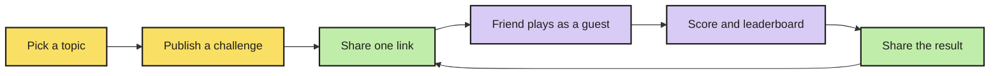

<p align="center">
  
</p>

<h1 align="center">⚡ ChallengeChain</h1>

<p align="center"><strong>Make a challenge. Start a chain.</strong></p>

<p align="center">Create a quiz from a topic, send one link, and see how your friends score. Anyone can create or play without an account.</p>

<p align="center">
  <a href="http://cc.tendry.mg/">🌐 Live app</a> ·
  <a href="http://cc.tendry.mg/create">✨ Create a challenge</a> ·
  <a href="https://youtu.be/J8VG_bTYnw4">▶ Watch the 2:52 customer journey</a>
</p>

---

## HackOnVibe submission at a glance

| | |
|---|---|
| **Project** | ChallengeChain · solo project for HackOnVibe November 2026 |
| **Try it** | [cc.tendry.mg](http://cc.tendry.mg/) — no sign-up required |
| **See the journey** | [2:52 video](https://youtu.be/J8VG_bTYnw4) showing what to click and the result |
| **What spreads** | A challenge link brings in a player; their result gives them a reason to share the next link |
| **Stack** | PHP 8.3+ · SQLite · vanilla JavaScript · OpenRouter-compatible AI · optional Docker |
| **Verification** | `php tests/run.php` — **127 checks passing** on the submitted code |

> **For judges:** Open the [live app](http://cc.tendry.mg/), choose **Create challenge**, publish one, then open its link in a private window to play as a guest. The PHP app runs on a VPS. HackOnVibe's automatic site publishing is disabled for this event, so its `verify` job can fail even when the repository build succeeds; the submitted live app URL is the one to test.

**Jump to:** [Customer journey](#the-customer-journey) · [Features](#what-works-today) · [Run locally](#run-it-locally) · [Docker](#run-with-docker) · [Verification](#verification-and-safeguards)

## Why this exists

Most quizzes end when the first group finishes. ChallengeChain makes the result the start of another round: a player sees their score, checks the leaderboard, and shares it with a friend. The friend can play immediately, with no registration step in the way.

The product focuses on one action that is easy to repeat: **create → share → play → compare → share again**.



## The customer journey

| Step | What happens | Where |
|---|---|---|
| **1. Create** | Pick a category, topic, difficulty, language and question count. Generate questions with AI or the built-in demo bank, review them, and publish. | [`/create`](http://cc.tendry.mg/create) |
| **2. Share** | The published challenge gets a unique link. Copy it or use the available share options. | `/challenge/{slug}` |
| **3. Play** | A friend opens the link, enters a name and answers without an account. | `/challenge/{slug}/play` |
| **4. Compare** | The server scores the attempt. The result and leaderboard show the score, number correct and rank. | `/result/{publicId}` · `/challenge/{slug}/leaderboard` |
| **5. Continue** | The player shares the result or starts a rematch, bringing the next person in. | Result page |

<p align="center">
  
</p>

## What works today

- **Guest-first flow.** Creating and playing challenges do not require an account. Accounts add a dashboard and profile.
- **Real challenge engine.** Questions, attempts and scores are stored in SQLite; answers are checked on the server and are not sent to players before submission.
- **Shareable results.** Each challenge and completed attempt has a public URL, with Open Graph metadata and sharing options.
- **Leaderboards.** The best attempt per player is ranked by score, with completion time breaking ties.
- **Creator insights.** Signed-in creators can see challenge views, participants, shares, referral visits and recent activity.
- **Optional AI.** OpenRouter-compatible generation is available with a server-side key; the app remains usable in clearly labelled demo mode without one.

### AI, with a working fallback

`AI_API_KEY` is optional. With a key, the backend requests structured quiz questions from the configured OpenRouter-compatible endpoint and validates the response before saving it. If the key is empty, a built-in question bank generates **Demo mode** challenges. The API key stays on the server; visitors never need one.

The default model route in [`.env.example`](.env.example) is `openrouter/free`. Availability of live generation depends on the configured provider and its limits; the demo path remains available without an external AI service.

## Run it locally

Requirements: PHP **8.3+** with `pdo_sqlite`, `sqlite3`, `curl`, `mbstring` and `openssl`, plus Composer.

```bash
composer install
cp .env.example .env
php scripts/migrate.php
composer serve
```

Open [http://localhost:8000](http://localhost:8000). On PowerShell, `Copy-Item .env.example .env` works in place of `cp`. Leave `AI_API_KEY` empty to try the full guest flow in demo mode. Optional local sample challenges: `php scripts/seed.php`.

### Run with Docker

```bash
cp .env.example .env
docker compose up --build -d
docker compose ps
```

Open [http://localhost:8080](http://localhost:8080). The PHP 8.4/Apache container runs migrations at startup; a named Docker volume keeps the SQLite database when the container stops. `docker compose down` leaves that volume intact. Set `DOCKER_APP_URL` and `CHALLENGECHAIN_PORT` if you use a reverse proxy or another local port.

## Architecture

```text
app/              Controllers, Models, Services, Views and core helpers
config/           Environment-backed application settings
database/         SQLite migrations
public/           Web root: index.php, styles, scripts and illustrations
routes/web.php    Public pages, authenticated pages and JSON API routes
scripts/          Migration, seed, AI diagnostics and deployment helpers
storage/          SQLite database and logs (outside the web root)
tests/            Application, security and HTTP resource checks
docker/           Apache virtual host and container startup script
```

The app uses native PHP MVC, PDO prepared statements and vanilla JavaScript. The web server must point to `public/`; the repository's root `index.html` is only a static landing page that links to the PHP app.

### Configuration

| Key | Purpose |
|---|---|
| `APP_URL` | Public URL for share links and previews; omit the trailing slash. |
| `DB_PATH` | SQLite file, kept outside `public/`. |
| `AI_API_KEY` | Optional server-side AI key; empty enables demo mode. |
| `AI_BASE_URL` / `AI_MODEL` | OpenRouter-compatible endpoint and model route. |
| `APP_ENV` / `APP_DEBUG` | Use `production` / `false` on a public server. |

Copy [`.env.example`](.env.example) to `.env` for the full list. `.env`, `vendor/`, SQLite data and logs are excluded from Git and from the Docker build context.

## Verification and safeguards

```bash
php tests/run.php
```

The **127 passing checks** cover registration and login, AI validation and demo fallback, guest publishing, scoring, duplicate submissions, leaderboards, public links, referrals, rate limits, escaping, database migrations and browser resource paths.

The app also uses CSRF tokens, escaped output, server-side scoring, rate limits and secure session settings under HTTPS. It does not publish correct answers before an attempt is submitted.

## Deployment note

The live PHP application is hosted separately on a PHP-capable VPS at [cc.tendry.mg](http://cc.tendry.mg/). Cloudflare Pages can serve the static landing page in this repository, but it cannot execute `public/index.php`. For a manual PHP deployment, point the web server document root to `public/`, install Composer dependencies, set production environment values, run migrations and allow the PHP user to write to `storage/`.

## License

MIT, as declared in [`composer.json`](composer.json).
